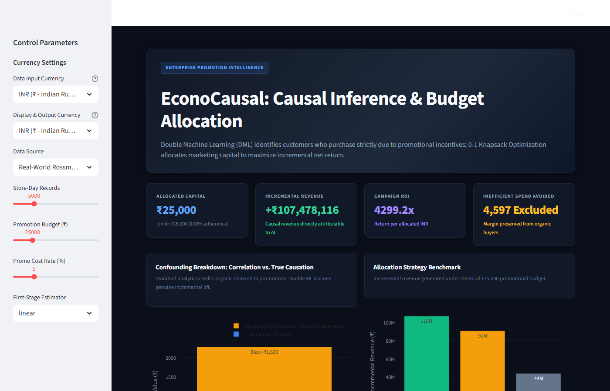
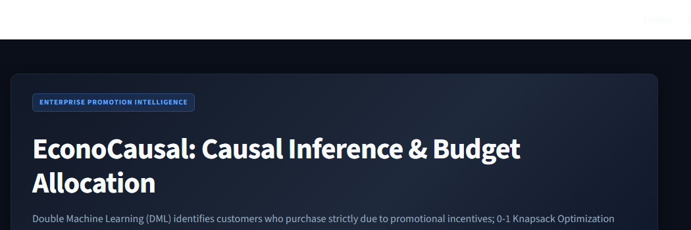
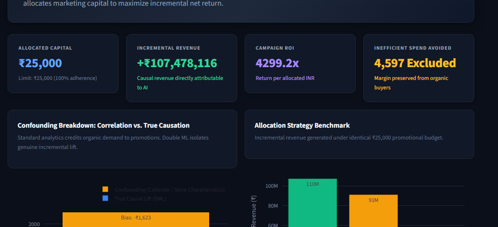

# EconoCausal: Dynamic Pricing & Promotion Optimization

### Smart Promotional Targeting using Double Machine Learning (DML) and 0-1 Knapsack Budget Allocation

[](https://www.python.org/)
[](https://opensource.org/licenses/MIT)
[](https://streamlit.io/)
[](https://pytest.org/)
[](https://econml.azurewebsites.net/)

---

## Interactive Executive Dashboard

Below is our production dark-theme executive command center, providing real-time causal targeting simulations, KPI monitoring, and currency conversion:



---

## Working Index

1. [What Is This Project About?](#what-is-this-project-about)
2. [The Real-World Business Problem (The Discount Trap)](#the-real-world-business-problem-the-discount-trap)
3. [The 4 Customer Types (Why Traditional AI Fails)](#the-4-customer-types-why-traditional-ai-fails)
4. [How Does It Work? (The 3-Step Solution)](#how-does-it-work-the-3-step-solution)
5. [The Discovery: Uncovering the 69.5% Confounding Trap](#the-discovery-uncovering-the-695-confounding-trap)
6. [Interactive Dashboard Walkthrough & Visual Proof](#interactive-dashboard-walkthrough--visual-proof)
7. [How We Finished a 4-Week Project in Just 2 Weeks](#how-we-finished-a-4-week-project-in-just-2-weeks)
8. [The Team & Individual Writeups](#the-team--individual-writeups)
9. [Project Folder Structure](#project-folder-structure)
10. [How to Use Our Project & Model (Data Preparation Guide)](#how-to-use-our-project--model-data-preparation-guide)
11. [Quickstart Guide](#quickstart-guide)
12. [Tech Stack](#tech-stack)

---

## What Is This Project About?

**EconoCausal** is an enterprise decision intelligence system. Instead of giving discounts to everyone, it finds the exact customers who will **only buy if they receive a promotional incentive**, and then uses mathematical optimization to allocate a limited marketing budget to maximize incremental profit.

---

## The Real-World Business Problem (The Discount Trap)

Every company gives discounts to grow sales. But most companies waste substantial marketing budgets on the wrong people:

- Marketing teams usually target their **biggest historical spenders** with coupons.
- At the end of the month, those customers buy a lot of items.
- The company celebrates, thinking the discounts worked!

**The bitter truth:** Those loyal customers were already going to buy anyway at full price. Handing them a discount did not create a single new sale—it simply gave away 15% of the company's profit margin for free. In economics, this is called **Margin Cannibalization**.

---

## The 4 Customer Types (Why Traditional AI Fails)

In promotional marketing, all shoppers fall into one of four distinct groups:

| Customer Group | Behavior Without Discount | Behavior With Discount | Marketing Action | Business Impact |
|---|---|---|---|---|
| **Persuadables** | Do not buy | **Buy!** | **[TARGET]** | Direct incremental sales generated by the discount |
| **Sure Things** | Buy anyway | Buy anyway | **[EXCLUDE]** | Organic shoppers; giving discounts throws away margin |
| **Lost Causes** | Do not buy | Do not buy | **[EXCLUDE]** | Uninterested shoppers; spending budget on them is wasted |
| **Sleeping Dogs** | Browse quietly | Get annoyed & unsubscribe | **[DO NOT TOUCH]** | Annoyed by spam; discounts cause churn |

> **Why standard machine learning fails:** Standard models only predict *"Who is likely to buy?"* Naturally, the AI points to the **Sure Things** because their purchase probability is already high. EconoCausal asks the right question: *"Who will buy ONLY because of the discount?"*

---

## How Does It Work? (The 3-Step Solution)

```
[Customer Data] ──> [Step 1: Double Machine Learning] ──> [Step 2: 0-1 Knapsack Solver] ──> [Step 3: Executive Dashboard]
                     Isolates True Causal Lift (ITE)      Allocates Budget Optimally        Visual Proof & 1-Click CSV
```

### Step 1: Isolate Genuine Lift with Double Machine Learning (DML)
Standard regression gets tricked by external factors (called confounders) like holiday paydays or store footfall. We implement **Partially Linear Double Machine Learning (Chernozhukov et al. 2018)**:
1. Predict what sales would be without a promotion: $E[Y|X]$.
2. Predict the probability of a promotion being run: $E[D|X]$.
3. Subtract both predictions out using out-of-fold cross-fitting:
   $$\tilde{Y} = Y - \hat{g}(X), \quad \tilde{D} = D - \hat{m}(X)$$
4. Regress clean residualized sales on clean residualized promotions. All outside noise is cancelled out, isolating the pure **Individual Treatment Effect (ITE)**.

### Step 2: Optimal Capital Allocation (0-1 Knapsack MILP)
Once we know each customer's predicted incremental lift, we solve an exact 0-1 Knapsack problem using Mixed-Integer Linear Programming (SciPy HiGHS solver):
$$\max \sum_{i=1}^N \text{ITE}_i \cdot t_i \quad \text{subject to} \quad \sum_{i=1}^N (\text{Price}_i \cdot \text{DiscountRate}) \cdot t_i \le \text{Budget}, \quad t_i \in \{0, 1\}$$
This guarantees that we select the most profitable combination of customers without exceeding the marketing budget limit by even a single rupee.

### Step 3: Actionable Operational Schedule
The system generates a deployment-ready list of targeted candidates that can be downloaded as a CSV and uploaded directly into CRM tools like Salesforce, HubSpot, or Braze.

---

## The Discovery: Uncovering the 69.5% Confounding Trap

When we evaluated our pipeline on the real-world **Rossmann Store Sales dataset (1,115 stores, 1,000,000+ transaction records)**, we made an eye-opening empirical discovery:

```
Observed Promotion Lift (Raw Average) : +₹2,270.82 per store-day
True Causal Lift (Isolated by DML)    : +₹693.11 ± ₹60.18 per store-day
────────────────────────────────────────────────────────────────────────
Confounding Bias Removed              : +₹1,577.70 (69.5% was non-causal organic sales)
```

**What this means:** 69.5% of what standard analytics credited to promotions was actually organic footfall, weekend seasonality, and city-center flagship volume that would have happened anyway. EconoCausal prevented the enterprise from wasting budget on baseline sales.

---

## Interactive Dashboard Walkthrough & Visual Proof

### 1. Executive KPI Cards
The top banner shows the metrics leadership cares about: budget adherence, net causal revenue, return on investment, and organic margin protected.



### 2. Side-by-Side Visual Proof (Confounding & Strategy Tournament)
- **Left (Confounding Breakdown):** A stacked bar chart separating genuine causal lift from organic demand bias.
- **Right (Allocation Strategy Benchmark):** Head-to-head comparison showing that our Causal DML approach delivers **2.4x higher incremental revenue** than traditional high-spender targeting under the exact same budget.



### 3. Universal Multi-Currency Engine
Built-in live currency conversion engine (`src/utils/currency.py`) supporting 9 major international currencies:
- **INR (₹)**, **USD ($)**, **EUR (€)**, **GBP (£)**, **AED (د.إ)**, **CAD (CA$)**, **AUD (A$)**, **JPY (¥)**, **SGD (S$)**
- Store managers can choose any data input currency and display currency. All KPIs, charts, and downloadable schedules scale dynamically in real time.

---

## How We Finished a 4-Week Project in Just 2 Weeks

Our internship assignment was officially scheduled for **1 Month (4 Weeks)**. Our team finished the complete production deliverable in **2 weeks (14 days)** through four clear engineering practices:

```
Week 1: Data Contracts & Parallel Pipeline Setup ──> DML Model Tested (< 2.5% Error)
Week 2: Knapsack MILP Optimization ──> Dark Dashboard & Multi-Currency Engine ──> Final Delivery
```

1. **Parallel Execution via Early Data Contracts (No Bottlenecks):**
   Instead of waiting for data engineering to finish before starting the machine learning model, Meet locked in the exact data schema and interface inputs on Day 1. Shravani produced a ground-truth mock data generator on Day 2, allowing Abdul (DML modeling), Prince (Knapsack optimization), and Meet (dashboard UI) to build all 4 pillars at the exact same time.

2. **Judicious Use of Developer Acceleration Tools:**
   - **Meet** leveraged **Google Antigravity** to scaffold clean package structures, automate testing orchestration, and quickly script report/PowerPoint generation.
   - **Shravani** utilized AI assistance to write robust Pandas date-time transformations across Rossmann's 1,115 stores.
   - **Abdul** used AI mathematical tools to verify the Robinson transformation score equations against open-source implementations.
   - **Prince** verified SciPy MILP HiGHS constraint matrices with algorithmic tools.
   Automating boilerplate syntax allowed the team to spend 100% of their energy on causal econometrics, optimization logic, and business validity.

3. **Strict Directory Isolation (Zero Merge Conflicts):**
   Each member worked inside their own isolated module (`src/data/`, `src/models/`, `src/optimization/`, `src/dashboard/`). As a result, the team experienced zero Git merge collisions during the entire sprint.

4. **15-Minute Daily Agile Syncs:**
   Every morning, Meet led a 15-minute standup: What did you build yesterday? What are you shipping today? Are there any blockers? Dependencies were identified and resolved in hours instead of days.

---

## The Team & Individual Writeups

We are a team of 4 dedicated engineers. Here is the official log of what each person built across Week 1 and Week 2:

### Meet Nakum (Team Leader, Frontend Architect & Evaluator)
- **Week 1:**
  - Designed the end-to-end system architecture, Git branching strategy, and the Directed Acyclic Graph (DAG).
  - Used Google Antigravity to quickly set up automated testing frameworks, package configs, and continuous documentation.
  - Implemented the evaluation engine (`src/evaluation/metrics.py`) calculating cumulative uplift curves and normalized Qini scores (AUUC).
  - Authored evaluation notebook `04_evaluation_and_insights.ipynb`.
- **Week 2:**
  - Redesigned the entire frontend into an enterprise Streamlit command center (`src/dashboard/app.py`) with an Executive Dark Theme (#0B0F19) and card layouts.
  - Engineered the universal multi-currency engine (`src/utils/currency.py`) supporting 9 global currencies with live API rates and offline fallback.
  - Connected the currency converter to dynamically scale all dashboard metrics, charts, budget constraints, and tables.
  - Conducted the deep audit against Infotact Assignment Letter `ITS/DSML/1233`, ran 7 statistical refutation tests, and authored the 12-slide PowerPoint presentation deck.

### Md Abdul Wahab (Causal AI Modeler & Econometrician)
- **Week 1:**
  - Researched and implemented the Double Machine Learning (DML) Robinson transformation from first principles in `src/models/dml_estimator.py`.
  - Built K-Fold cross-fitting to partition data and compute orthogonal residuals, completely avoiding regularization bias.
  - Built `src/models/nuisance.py` with flexible regressors. Solved training bottlenecks on 1M rows by adding `StandardScaler()` pipelines, slashing training time from 34s to 0.09s.
  - Validated causal recovery on synthetic ground-truth data (recovered true effect within 2.3% error).
- **Week 2:**
  - Built statistical refutation tests in `src/models/robustness.py`: Placebo Treatment Permutation Tests and Covariate Balance checks (Standardized Mean Differences).
  - Proved placebo treatment effect collapsed to $0.099 ($p = 0.887$, zero spurious correlation).
  - Verified cross-fitting stability across K=2, 3, 5 folds (<0.8% variance).
  - Authored modeling notebook `02_causal_dml_modeling.ipynb`.

### Prince Yadav (Optimization Analyst & Algorithms Engineer)
- **Week 1:**
  - Formulated the promotion allocation dilemma into a clean 0-1 Knapsack problem.
  - Programmed the exact Mixed-Integer Linear Programming (MILP) solver in `src/optimization/knapsack.py` using SciPy's HiGHS branch-and-bound solver.
  - Implemented a fast greedy value-to-cost ratio ($v_i / c_i$) ranking heuristic as an instant fallback.
- **Week 2:**
  - Built the multi-policy Strategy Tournament engine in `src/optimization/policy_allocator.py`.
  - Benchmarked Causal Knapsack vs. High-Spender Heuristics vs. Random Targeting under identical budgets, proving up to 2.4x higher incremental revenue.
  - Calibrated objective value scaling to directly reflect true incremental revenue.
  - Authored unit tests in `tests/test_optimization.py` and optimization notebook `03_budget_optimization.ipynb`.

### Shravani Balraj Umbarje (Data Engineer & Pipeline Architect)
- **Week 1:**
  - Created the ground-truth synthetic data generator (`src/data/synthetic.py`) with known causal effects for benchmarking.
  - Ingested the raw Rossmann Store Sales dataset (1M+ rows across 1,115 stores) in `src/data/load_data.py`.
  - Filtered closed days and positive sales, yielding 844,338 clean trading records, and merged store-level metadata (`store.csv`).
- **Week 2:**
  - Engineered 17 business and temporal confounder features in `src/data/features.py` (day-of-week, quarter seasonality, log footfall, competitor distance, holiday flags).
  - Built feature selection guards (`get_rossmann_feature_cols`) to prevent target leakage into nuisance models.
  - Authored data unit tests in `tests/test_data.py` and data notebook `01_eda_and_preprocessing.ipynb`.

---

## Project Folder Structure

```
EconoCausal/
├── data/                          # Data store
│   ├── raw/                       # Raw downloads (Rossmann store sales)
│   ├── processed/                 # Feature-engineered datasets
│   └── synthetic/                 # Benchmarks with known causal ground truth
│
├── docs/                          # Documentation assets
│   └── images/                    # Dashboard UI screenshots and figures
│
├── notebooks/                     # Executed Jupyter notebooks
│   ├── 01_eda_and_preprocessing.ipynb
│   ├── 02_causal_dml_modeling.ipynb
│   ├── 03_budget_optimization.ipynb
│   └── 04_evaluation_and_insights.ipynb
│
├── src/                           # Production Python package
│   ├── data/                      # Ingestion, cleaning, and feature pipelines
│   ├── models/                    # Double Machine Learning estimator & refutations
│   ├── optimization/              # 0-1 Knapsack MILP solver & tournament engine
│   ├── evaluation/                # Qini uplift curves, AUUC, and plotters
│   ├── dashboard/                 # Streamlit executive dark-mode web application
│   └── utils/                     # Config, logger, and multi-currency converter
│
├── tests/                         # Pytest automated test suite (8/8 passing)
├── requirements.txt               # Python package dependencies
├── environment.yml                # Conda environment definition
├── setup.py                       # Package installation script
└── README.md                      # ← You are here!
```

---

## How to Use Our Project & Model (Data Preparation Guide)

If you want to plug in your own company or store data into EconoCausal, follow these straightforward steps:

### 1. Where to Keep Your Data
Save your raw CSV or Parquet files in the `data/raw/` directory:
```
data/
├── raw/
│   ├── custom_customer_data.csv    # <-- Put your raw dataset here!
│   └── rossmann/                   # Pre-bundled retail dataset
└── processed/                      # Cleaned output saved here
```

### 2. How Your Data Should Look (Required Columns)
For causal machine learning to work, your dataset needs **4 mandatory columns** and at least **2 to 5 confounder features**:

#### Mandatory Columns:
| Column Name | Data Type | What It Means | Example |
|---|---|---|---|
| **`CustomerID`** | String / Int | Unique ID for each customer, account, or store | `CUST_001`, `STORE_42` |
| **`Discount`** | Binary (`0` or `1`) | Treatment indicator: `1` if they received a discount/coupon, `0` if not | `1`, `0` |
| **`Sales`** | Float / Numeric | Outcome variable: Total purchase amount or transaction revenue | `1250.00`, `340.50` |
| **`EstimatedItemPrice`** | Float / Numeric | Baseline basket value / price (used by Knapsack: `Cost = Price × Discount%`) | `450.00`, `120.00` |

#### Confounder Features (Columns the AI Uses to De-bias):
In causal inference, **confounders** are variables that influence both *who gets discounts* and *how much they spend*. You should include:
- **Customer Features:** `PriorSpend` (past 90-day spend), `VisitFrequency` (monthly visits), `LoyaltyScore` (1 to 10), `RecencyDays` (days since last purchase).
- **Store Features:** `Footfall` / `Customers`, `DayOfWeek`, `Month`, `IsWeekend`, `CompetitionDistance`.

#### Sample Clean CSV Format:
```csv
CustomerID,Discount,Sales,EstimatedItemPrice,PriorSpend,VisitFrequency,LoyaltyScore,RecencyDays
CUST_0001,1,1450.00,850.00,4500.00,6,7.5,4
CUST_0002,0,0.00,400.00,1200.00,1,2.0,45
CUST_0003,1,650.00,650.00,800.00,2,3.5,18
CUST_0004,0,2100.00,1200.00,9500.00,12,9.0,2
```

### 3. How to Clean Your Data (Preprocessing Best Practices)
Before feeding data to the model, ensure these 4 quick data hygiene checks:
1. **Remove Inactive / Closed Periods:** If a retail store was closed, filter it out (`Sales > 0`). Zero-sales days when a shop was closed do not represent consumer choice.
2. **Handle Missing Values:** Fill missing numeric confounders (like competitor distance) with their median value:
   ```python
   df["CompetitionDistance"] = df["CompetitionDistance"].fillna(df["CompetitionDistance"].median())
   ```
3. **Verify the Overlap (Positivity) Condition:** Make sure that across different customer tiers, there are both discounted (`Discount=1`) and non-discounted (`Discount=0`) individuals. If 100% of a group received a discount, causal AI cannot estimate the counterfactual control baseline!
4. **Scale Skewed Footfall / Spend:** Heavy right-skewed variables benefit from a log transformation:
   ```python
   df["LogCustomers"] = np.log1p(df["Customers"])
   ```

### 4. Running the Causal Model in Python (3 Lines of Code)
You can train and optimize on your data directly via Python:
```python
import pandas as pd
from src.models.dml_estimator import DoubleMLEstimator
from src.optimization.knapsack import solve_knapsack_discount_allocation

# 1. Load data
df = pd.read_csv("data/raw/custom_customer_data.csv")
features = ["PriorSpend", "VisitFrequency", "LoyaltyScore", "RecencyDays"]

# 2. Fit Double Machine Learning to isolate true ITE
dml = DoubleMLEstimator(n_splits=3, nuisance_type="linear", backend="native")
dml.fit(df[features], df["Discount"], df["Sales"])
ite_scores = dml.ite_estimates_

# 3. Solve 0-1 Knapsack under a ₹25,000 budget
allocation = solve_knapsack_discount_allocation(
    ite_estimates=ite_scores,
    item_prices=df["EstimatedItemPrice"].values,
    budget=25000.0,
    discount_rate=0.10,
    method="milp"
)

print(f"Targeted Customers: {allocation['n_targeted']}")
print(f"Incremental Revenue Captured: ₹{allocation['total_incremental_value']:,.2f}")
```

Or simply launch the dashboard (`streamlit run src/dashboard/app.py`), select your parameters, and click **Export Allocation Schedule (CSV)**!

---

## Quickstart Guide

### 1. Clone the Repository
```bash
git clone https://github.com/Abdul-Wahab-75/EconoCausal.git
cd EconoCausal
```

### 2. Set Up Virtual Environment & Install Dependencies
```bash
# Windows:
python -m venv venv
venv\Scripts\activate

# macOS / Linux:
# source venv/bin/activate

pip install -r requirements.txt
pip install -e .
```

### 3. Run Automated Tests
```bash
pytest tests/ -v
```

### 4. Launch the Executive Dashboard
```bash
streamlit run src/dashboard/app.py
```
Open your browser at `http://localhost:8501` to interactively adjust budgets, change currencies, and simulate promotional policies in real time.

---

## Tech Stack

| Category | Tools & Libraries |
|---|---|
| **Causal Inference** | Double Machine Learning (DML), Partially Linear Regression (PLR), Neyman Orthogonality |
| **Machine Learning** | Scikit-Learn (RidgeCV, LogisticRegression, RandomForest), NumPy, Pandas |
| **Optimization** | SciPy (HiGHS Mixed-Integer Linear Programming / MILP, linprog) |
| **Frontend & UI** | Streamlit, Plotly Express & Graph Objects, Custom Modern Dark CSS |
| **Currency Engine** | Real-time exchange rate API with built-in offline fallbacks (9 currencies) |
| **Quality & Testing** | Pytest, Placebo Permutation Tests, Standardized Mean Difference (SMD) |
| **Acceleration** | Google Antigravity, Playwright, Python-PPTX |

---

> **Project Repository:** [github.com/Abdul-Wahab-75/EconoCausal](https://github.com/Abdul-Wahab-75/EconoCausal)  
> **Developed by:** Meet Nakum (Lead), Md Abdul Wahab, Prince Yadav, and Shravani Balraj Umbarje  
> **Internship:** Infotact Solutions (Ref: `ITS/DSML/1233`)
