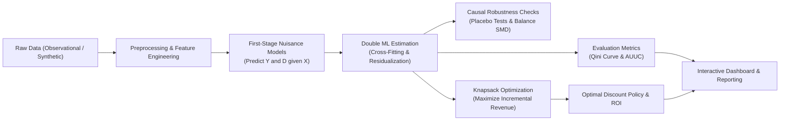

# 📈 EconoCausal: Causal Inference & Double Machine Learning for Optimal Discount Allocation

[](https://www.python.org/)
[](https://econml.azurewebsites.net/)
[](https://scipy.org/)
[](LICENSE)

> **Repository**: [https://github.com/Abdul-Wahab-75/EconoCausal](https://github.com/Abdul-Wahab-75/EconoCausal)

---

## 📌 1. Project Overview & Business Goal

Retailers and digital platforms frequently offer discounts to boost revenue. However, traditional marketing models rely on **predictive correlation** (e.g. predicting who will buy), which suffers from severe inefficiencies:
- **"Sure Things"**: Loyal, high-spend customers who would have purchased regardless of a discount receive promotions, causing needless margin loss.
- **"Lost Causes"**: Customers who will not buy even with a discount waste promotional spend.
- **"Persuadables"**: Customers who purchase **only when incentivized** by a discount are often overlooked.

### 🎯 Core Objective
**EconoCausal** builds an end-to-end causal AI and optimization system to:
1. Estimate each customer's **Individual Treatment Effect (ITE)** (the causal uplift in purchases attributable specifically to receiving a discount) using **Double Machine Learning (DML)**.
2. Formulate and solve a **0-1 Knapsack Optimization** problem to allocate a finite discount budget, maximizing incremental sales while avoiding margin waste on loyal buyers.
3. Deliver reproducible notebooks, production-grade modular Python code, an interactive demonstration dashboard, and defensible validation metrics.

---

## 🔬 2. Methodology & Causal Framework



### 2.1 Causal DAG & Core Assumptions
- **Outcome ($Y$)**: Total purchase value / Sales.
- **Treatment ($D$)**: Binary discount indicator ($1 =$ discount offered, $0 =$ control).
- **Confounders ($X$)**: Customer history (past spend, visit frequency, loyalty score), demographics, and temporal factors.

**Key Causal Assumptions:**
1. **Unconfoundedness (Conditional Ignorability)**: $(Y(0), Y(1)) \perp D \mid X$ — all variables simultaneously influencing discount assignment and purchase are observed.
2. **Positivity (Overlap)**: $0 < P(D=1 \mid X) < 1$ for all customer segments.
3. **SUTVA (No Interference)**: One customer's discount assignment does not impact another customer's buying decision.

### 2.2 Double Machine Learning (DML / Robinson Transformation)
We specify a partially linear model (PLR):
$$Y = g(X) + \theta(X) \cdot D + \epsilon, \quad E[\epsilon \mid X, D] = 0$$
$$D = m(X) + \eta, \quad E[\eta \mid X] = 0$$

Using $K$-fold cross-fitting to eliminate regularization and overfitting bias:
1. **First-Stage Nuisance Models**: Fit ML learners (Random Forest / LightGBM) to predict $\hat{g}(X) = \hat{E}[Y|X]$ and $\hat{m}(X) = \hat{E}[D|X]$.
2. **Neyman Orthogonal Residualization**: Compute $\tilde{Y} = Y - \hat{g}(X)$ and $\tilde{D} = D - \hat{m}(X)$.
3. **Second-Stage Causal Estimation**: Regress $\tilde{Y}$ on $\tilde{D}$ to recover $\hat{\theta}$ (ATE) and customer-level $\hat{\theta}_i$ (ITE).

### 2.3 Budget-Constrained Optimization (0-1 Knapsack)
Given estimated ITE $\hat{\theta}_i$, item prices $p_i$, discount costs $c_i = p_i \times \text{rate}$, and total marketing budget $B$:
$$\max \sum_{i=1}^N (\hat{\theta}_i \cdot p_i) \cdot t_i \quad \text{subject to} \quad \sum_{i=1}^N c_i \cdot t_i \le B, \quad t_i \in \{0, 1\}$$
Solved via SciPy Mixed-Integer Linear Programming (`scipy.optimize.milp` using the HiGHS solver).

---

## 👥 3. 4-Member Team Ownership & Role Matrix

To ensure all 4 team members can push their tasks without Git merge conflicts, ownership is strictly compartmentalized across independent modules:

| Member / Role | Primary Ownership (Code & Notebooks) | Key Deliverables & Responsibilities |
|---|---|---|
| **Member 1: Data Engineer** | `src/data/`<br>`notebooks/01_eda_and_preprocessing.ipynb`<br>`data/` | Ingest datasets (Rossmann/synthetic), handle nulls, encode features, build RFM features, check confounder balance, export clean data. |
| **Member 2: Causal Modeler** | `src/models/`<br>`notebooks/02_causal_dml_modeling.ipynb`<br>`models/` | Implement first-stage nuisance models, cross-fitting, Double ML (EconML / DoubleML), compute ITEs, run Placebo refutations & SMD balance checks. |
| **Member 3: Optimization Analyst** | `src/optimization/`<br>`notebooks/03_budget_optimization.ipynb` | Formulate 0-1 Knapsack & ILP solvers, implement budget constraints, benchmark Causal Policy vs Heuristic vs Random, compute ROI. |
| **Member 4: Project Lead & Evaluation** | `src/evaluation/`<br>`src/dashboard/`<br>`notebooks/04_evaluation_and_insights.ipynb`<br>`reports/` | Compute Qini curves, AUUC, decile lift charts, build Streamlit interactive demo dashboard, compile final report and presentation slides. |

---

## 🗓️ 4. 12-Week Sprint Roadmap

```
Week 01-02: [Sprint 1] Foundations & Architecture (Literature review, DAG, Repo setup)
Week 03-04: [Sprint 2] Data Acquisition & EDA (ETL pipeline, synthetic generator, EDA)
Week 05-06: [Sprint 3] Causal Model Prototyping (Nuisance models, cross-fitting, preliminary ITEs)
Week 07-08: [Sprint 4] Model Tuning & Robustness (Placebo checks, SMD balance, hyperparameter tuning)
Week 09-10: [Sprint 5] Budget Optimization & Integration (Knapsack ILP solver, policy benchmarks)
Week 11-12: [Sprint 6] Evaluation, Demo & Reporting (Qini curves, Streamlit app, final slides & paper)
```

- **Weeks 1–2 (Sprint 1)**: Study Double ML theory (Chernozhukov et al. 2018), map causal DAG, establish Git conventions and repository foundation.
- **Weeks 3–4 (Sprint 2)**: Acquire raw datasets (Rossmann/UCI/Synthetic), clean missing values, build feature transformers, write EDA notebook.
- **Weeks 5–6 (Sprint 3)**: Implement DML pipeline with Random Forest/GBDT nuisance predictors, verify residualization, generate initial ITE estimates.
- **Weeks 7–8 (Sprint 4)**: Execute placebo refutations (treatment shuffling), compute Standardized Mean Differences (SMD), tune tree depth and learning rates.
- **Weeks 9–10 (Sprint 5)**: Implement 0-1 Knapsack using SciPy MILP, compare causal policy against traditional high-spender heuristic, calculate incremental ROI.
- **Weeks 11–12 (Sprint 6)**: Plot Qini and cumulative gain curves, polish the interactive Streamlit demo (`src/dashboard/app.py`), finalize the research report and 12-slide presentation deck.

---

## 📁 5. Repository Structure

```
EconoCausal/
├── .github/
│   ├── workflows/
│   │   └── ci.yml                     # Continuous Integration test runner
│   └── PULL_REQUEST_TEMPLATE.md       # PR template for 4-member task submission
├── artifacts/                         # Generated plots, metrics JSON, output tables
├── data/
│   ├── raw/                           # Raw downloaded datasets (gitignored)
│   ├── processed/                     # Preprocessed data tables
│   └── synthetic/                     # Generated benchmark data
├── models/                            # Saved trained model artifacts (.pkl/.joblib)
├── notebooks/
│   ├── 01_eda_and_preprocessing.ipynb # Member 1: EDA & data cleaning
│   ├── 02_causal_dml_modeling.ipynb   # Member 2: DML estimation & robustness
│   ├── 03_budget_optimization.ipynb   # Member 3: Knapsack optimization
│   └── 04_evaluation_and_insights.ipynb# Member 4: Qini curves & metrics
├── reports/
│   ├── figures/                       # Publication-ready figures
│   ├── final_report.md                # Comprehensive technical report
│   └── presentation_outline.md        # 12-slide presentation structure
├── src/                               # Modular Python Package (`pip install -e .`)
│   ├── __init__.py
│   ├── utils/
│   │   ├── config.py                  # Project paths & default hyperparameters
│   │   └── logger.py                  # Standardized logging
│   ├── data/                          # [Member 1] Data pipelines
│   │   ├── load_data.py
│   │   ├── preprocess.py
│   │   ├── synthetic.py
│   │   └── features.py
│   ├── models/                        # [Member 2] Causal inference
│   │   ├── nuisance.py
│   │   ├── dml_estimator.py
│   │   └── robustness.py
│   ├── optimization/                  # [Member 3] Knapsack & allocation
│   │   ├── knapsack.py
│   │   └── policy_allocator.py
│   ├── evaluation/                    # [Member 4] Uplift & Qini
│   │   ├── metrics.py
│   │   └── visualizations.py
│   └── dashboard/                     # [Team / Member 4] Interactive demo
│       └── app.py
├── tests/                             # Automated test suite
│   ├── test_data.py
│   ├── test_models.py
│   ├── test_optimization.py
│   └── test_evaluation.py
├── .gitignore
├── environment.yml                    # Conda environment definition
├── requirements.txt                   # Pip dependency definitions
├── setup.py                           # Package installation setup
└── README.md                          # Main project documentation
```

---

## 🚀 6. Getting Started

### 6.1 Clone & Setup Environment
```bash
# Clone the repository
git clone https://github.com/Abdul-Wahab-75/EconoCausal.git
cd EconoCausal

# Create and activate a virtual environment
python -m venv venv
# On Windows:
venv\Scripts\activate
# On Linux/macOS:
source venv/bin/activate

# Install dependencies and editable package
pip install --upgrade pip
pip install -r requirements.txt
pip install -e .
```

### 6.2 Run Automated Tests
```bash
pytest tests/ -v
```

### 6.3 Launch Interactive Demo Dashboard
```bash
streamlit run src/dashboard/app.py
```

### 6.4 Launch Jupyter Lab
```bash
jupyter lab
```

---

## 🤝 7. GitHub Team Collaboration Guidelines

To work smoothly across 4 contributors on `https://github.com/Abdul-Wahab-75/EconoCausal`:

1. **Branch Naming Standard**:
   - `member1/data-pipeline`
   - `member2/dml-modeling`
   - `member3/knapsack-optimization`
   - `member4/evaluation-dashboard`

2. **Daily Development Flow**:
   ```bash
   # Update your local main branch
   git checkout main
   git pull origin main

   # Create or switch to your feature branch
   git checkout -b memberX/feature-name

   # Make changes in your assigned module (src/data, src/models, etc.)
   git add src/data/...
   git commit -m "feat(data): add RFM feature engineering and scaling"

   # Push to your remote feature branch
   git push -u origin memberX/feature-name
   ```

3. **Pull Request Protocol**:
   - Open a PR from `memberX/feature-name` into `main`.
   - Fill in the provided PR checklist (`.github/PULL_REQUEST_TEMPLATE.md`).
   - Have at least one other team member review the PR before merging.
   - **Never push large raw CSV datasets or binary model checkpoints directly to Git** (these are handled via `.gitignore`).
